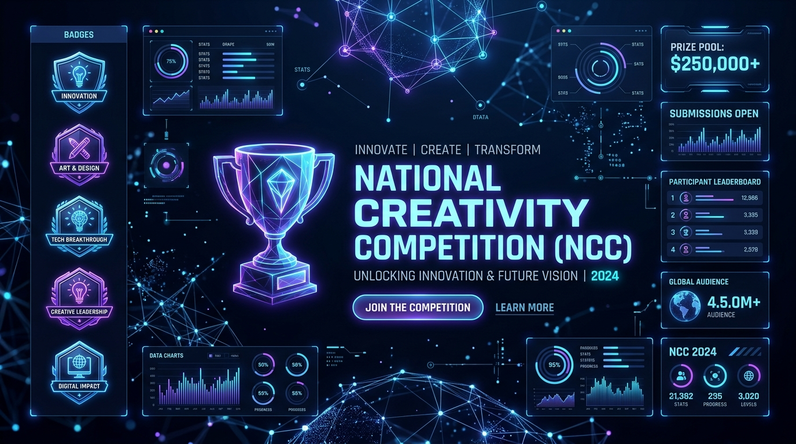
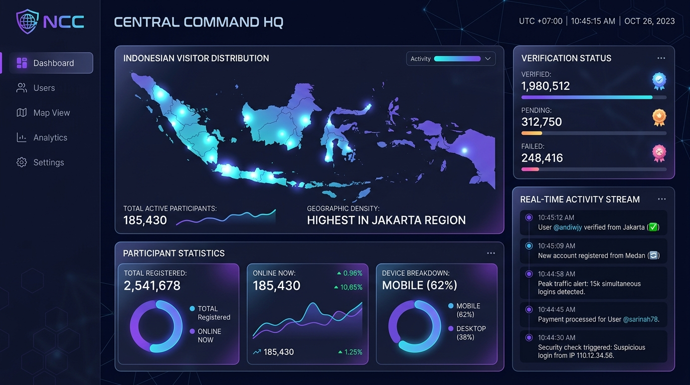
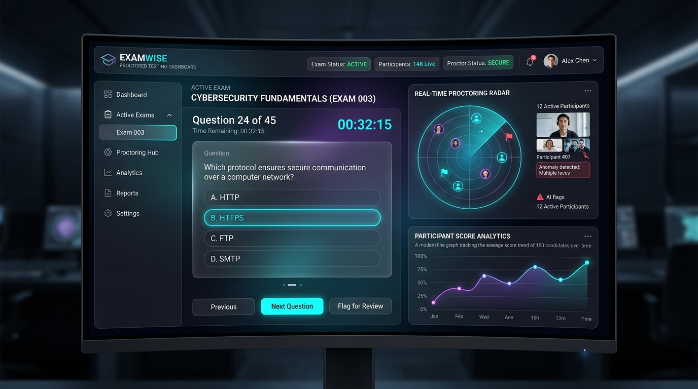
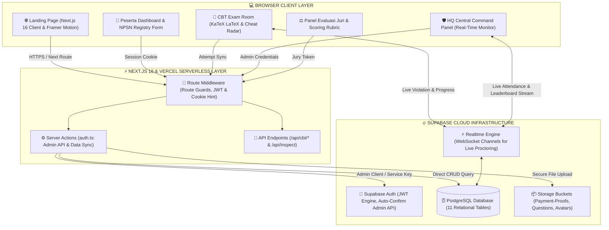
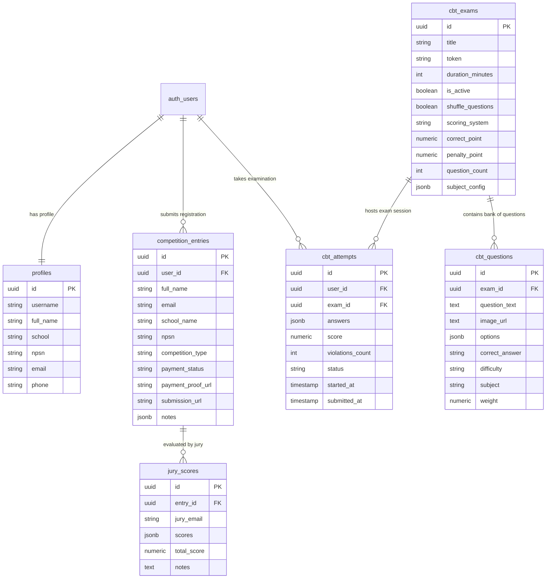
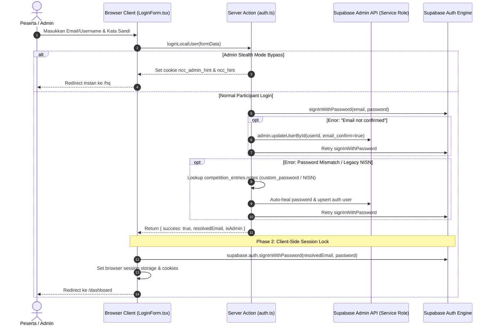

<p align="center">
  
</p>

<h1 align="center">🏆 National Creativity Competition (NCC 13th)</h1>

<p align="center">
  <strong>Production-Ready Full-Stack Competition Platform & Real-Time Computer-Based Testing (CBT) System</strong><br>
  Built with Next.js 16 (App Router), React 19, TypeScript, Supabase PostgreSQL, Realtime WebSockets, and Tailwind CSS v4.
</p>

<p align="center">
  <a href="https://national-creativty-competition.vercel.app"></a>
  <a href="https://github.com/luthfi5372/National-Creativty-Competition"></a>
  
  
  
  
  
  
</p>

---

## 🌟 Executive Summary & Portfolio Overview

**National Creativity Competition (NCC 13th)** adalah platform web kompetisi skala nasional terintegrasi (*end-to-end competition ecosystem*) yang dirancang untuk mengelola ribuan peserta dari **34 provinsi di seluruh Indonesia**. Platform ini tidak hanya melayani pendaftaran dan pembayaran, melainkan juga menyertakan **Engine Ujian Berbasis Komputer (CBT)** berstandar olimpiade dengan sistem **Proctoring Anti-Curang Realtime**, **Admin Command Center HQ**, serta **Portal Evaluasi Juri Berbasis Rubrik**.

Sistem ini dibangun dengan fokus pada performa tinggi, keamanan tingkat enterprise (*Row Level Security*), serta ketahanan terhadap kegagalan jaringan saat ujian berlangsung.

### 💡 Key Engineering Feats & Solved Challenges

1. **High-Concurrency Registration (Bypassing Supabase Free Email Rate Limits)**:
   - *Problem*: Layanan email bawaan Supabase Free Tier memiliki batas ketat (3–4 email per jam), yang menyebabkan error `email rate limit exceeded` saat lonjakan pendaftaran.
   - *Solution*: Mengarsiteki Server Action khusus berbasis **Admin Service Role API (`admin.createUser` dengan `email_confirm: true`)**. Akun peserta langsung aktif dan terverifikasi secara instan tanpa perlu memicu email konfirmasi, memungkinkan ribuan pendaftaran serentak tanpa batas.

2. **Real-Time Proctoring & Anti-Cheat Radar Engine**:
   - Sistem deteksi kecurangan otomatis berbasis *Page Visibility API*, *Window Blur Detection*, *Clipboard Interception (Anti Copy-Paste)*, serta *Fullscreen Enforcer*.
   - Setiap pelanggaran tercatat secara instan ke WebSocket Supabase Realtime dan ditayangkan langsung di dashboard pengawas (*HQ Monitor*). Mencapai batas toleransi pelanggaran akan memicu **Auto-Submit Paksa**.

3. **Zero-Latency Exam Auto-Save & Crash Recovery**:
   - Penyimpanan jawaban otomatis ke PostgreSQL di setiap klik peserta dengan *debounce* cerdas.
   - Logika timer cerdas berbasis *server-side elapsed time*: jika browser peserta ditutup, komputer restart, atau koneksi terputus, timer ujian akan tetap akurat saat halaman dibuka kembali tanpa reset waktu.

4. **Smart Subject-Based Question Distribution (Fisher-Yates Shuffle)**:
   - Mendukung bank soal gabungan multi-mata pelajaran (misal: Matematika 25 soal, Biologi 15 soal).
   - Pengacakan soal dan opsi jawaban menggunakan algoritma *Fisher-Yates* terkalibrasi untuk menjamin setiap peserta menerima urutan soal unik namun dengan komposisi bobot seimbang.

5. **Display-Aware Dynamic Responsive Navigation**:
   - Bilah navigasi *floating pill* adaptif yang menyesuaikan ukuran dari layar ponsel terkecil (320px) hingga monitor 4K.
   - Mencegah masalah umum CSS *flex-squishing* dengan strategi `shrink-0` dan transisi dinamis antar breakpoint tablet, laptop 1024px, dan desktop ultra-wide.

6. **Interactive 34-Province Geospatial Analytics**:
   - Visualisasi peta interaktif Indonesia (`<IndonesiaMap />`) berbasis SVG vektor yang memetakan persebaran demografis pendaftar secara langsung (*live streaming*).

---

## 📸 Visual Showcase

<div align="center">
  <h3>🛡️ Central Command HQ (Live Monitoring & Administration)</h3>
  
  <p><em>Pusat komando admin: Verifikasi bukti bayar, manajemen peserta, live broadcast pengumuman, dan pemantauan geografis 34 provinsi.</em></p>
</div>

<br>

<div align="center">
  <h3>📝 CBT Examination Suite & Live Anti-Cheat Radar</h3>
  
  <p><em>Ruang pengerjaan ujian olimpiade: Rendering rumus LaTeX matematika/sains, timer real-time tersinkronisasi, dan radar indikator kecurangan.</em></p>
</div>

---

## 📋 Daftar Isi

1. [Fitur-Fitur Utama Platform](#-fitur-fitur-utama-platform)
2. [Visualisasi Arsitektur Sistem](#-visualisasi-arsitektur-sistem)
3. [Visualisasi Database Schema (ERD)](#-visualisasi-database-schema-erd)
4. [Alur Autentikasi & Self-Healing](#-alur-autentikasi--self-healing)
5. [Siklus Ujian CBT & Proctoring](#-siklus-ujian-cbt--proctoring)
6. [Tech Stack & Architecture Decisions](#-tech-stack--architecture-decisions)
7. [Struktur Folder & Komponen](#-struktur-folder--komponen)
8. [Panduan Menjalankan Lokal](#-panduan-menjalankan-lokal)
9. [Environment Variables](#-environment-variables)
10. [Halaman & Route Guards](#-halaman--route-guards)
11. [Panduan Modifikasi & Kodingan Bebas Error (Developer's Manual)](#-panduan-modifikasi--kodingan-bebas-error-developers-manual)
12. [Troubleshooting & Solusi Error](#-troubleshooting--solusi-error)
13. [Profil & Kontak Pengembang](#-profil--kontak-pengembang)

---

## ⚡ Fitur-Fitur Utama Platform

| Modul | Kemampuan & Keunggulan Teknis | File Kunci |
|---|---|---|
| **🌐 High-Performance Landing Page** | Animasi dinamis 60fps dengan Framer Motion, 3D Canvas ornamen, floating pill navbar adaptif, countdown kompetisi, dan integrasi WhatsApp CS. | `src/components/HomeClient.tsx`<br>`src/components/Navbar.tsx` |
| **👤 Portal Mandiri Peserta** | Pendaftaran berbasis auto-lookup NPSN sekolah, generate Kartu Peserta ID visual, upload bukti pembayaran ke Supabase Storage, dan live timeline gelombang. | `src/app/dashboard/page.tsx`<br>`src/components/dashboard/*` |
| **📝 CBT Online Examination Room** | Dukungan rumus matematika/fisika LaTeX (KaTeX), pengacakan opsi dan soal per mata pelajaran, auto-save jawaban ke database, serta navigasi nomor soal instan. | `src/app/ujian/[exam_id]/page.tsx` |
| **🛡️ Real-Time Proctoring Radar** | Deteksi tab switch, anti copy-paste, fullscreen lock, counter pelanggaran dengan warning popup otomatis, dan diskualifikasi/auto-submit paksa. | `src/components/exam/CheatRadar.tsx`<br>`src/hooks/useAdvancedProctoring.ts` |
| **👑 Central Command HQ** | Panel admin komprehensif: verifikasi slip transfer, ekspor data CSV ber-quote aman, live WebSocket monitoring ujian, dan broadcast darurat. | `src/app/hq/page.tsx`<br>`src/app/hq/llms/page.tsx` |
| **⚖️ Portal Penjurian (Jury Hub)** | Akses juri khusus untuk menilai karya non-CBT (LKTI, Speech, MTQ), formulir skor rubrik dinamis, dan kalkulasi nilai teragregasi. | `src/app/juri/page.tsx`<br>`src/app/juri/eval/[id]/page.tsx` |
| **🗺️ Geospatial Distribution Map** | Peta interaktif SVG 34 provinsi dengan indikator densitas pendaftar, drilldown per pulau, dan live refresh data statistik. | `src/components/IndonesiaMap.tsx` |

---

## 🏗 Visualisasi Arsitektur Sistem

Diagram berikut menggambarkan bagaimana layer antarmuka pengguna, logika server Next.js 16, dan infrastruktur backend Supabase berkomunikasi secara aman:



---

## 🗄 Visualisasi Database Schema (ERD)

Skema database PostgreSQL yang menopang seluruh operasional kompetisi:



---

## 🔑 Alur Autentikasi & Self-Healing

Mekanisme autentikasi dilengkapi dengan **Self-Healing Session Recovery** dan **Admin API Bypass** untuk menjamin peserta tidak pernah terblokir oleh masalah konfirmasi email:



---

## ⏱️ Siklus Ujian CBT & Proctoring

Alur pengerjaan ujian peserta mulai dari validasi token hingga auto-submit berbasis radar pelanggaran:

```mermaid
flowchart LR
    A["🔑 Masuk Token Ujian"] --> B["📋 Dashboard Verifikasi Peserta"]
    B --> C["⏱️ Mulai Ujian (started_at terkunci)"]
    C --> D["📝 Pengerjaan Soal (Smart Shuffle & Mapel)"]
    
    subgraph Proctoring["🛡️ Proctoring Radar Engine"]
        D -.->|Deteksi Tab Switch / Blur| W1["⚠️ Peringatan Pelanggaran #1"]
        W1 -.->|Deteksi Copy Paste / Esc| W2["⚠️ Peringatan Pelanggaran #2"]
        W2 -.->|Pelanggaran ke-3| W3["🚨 Auto-Submit Paksa"]
    end

    D -->|Waktu Habis / Tombol Selesai| Submit["🏁 Finalisasi & Submit Jawaban"]
    W3 --> Submit
    Submit --> Scoring["📊 Auto-Grading (Fixed / Custom / Penalty)"]
    Scoring --> Leaderboard["🏆 Real-Time Leaderboard HQ"]
```



---

## 🛠 Tech Stack & Architecture Decisions

| Kategori | Teknologi | Alasan Pemilihan & Nilai Rekayasa |
|---|---|---|
| **Framework** | **Next.js 16 (App Router)** | Rendering hybrid (SSR, ISR, CSR), arsitektur Server Actions yang mengamankan mutasi database tanpa eksposur endpoint publik. |
| **Library UI** | **React 19 & TypeScript 5** | Manajemen tipe statis yang ketat untuk mencegah runtime bugs, hook performa tinggi, dan clean component hierarchy. |
| **Styling** | **Tailwind CSS v4** | Utility-first CSS modern dengan kompilasi instan, CSS custom properties, dan dukungan penuh untuk responsive design modular. |
| **Animasi & Interaksi**| **Framer Motion & GSAP** | Animasi transisi halaman mulus, dialog modal interaktif, dan efek hover responsif tanpa drop frame. |
| **Database & Auth** | **Supabase (PostgreSQL 15)** | Skema relasional yang tangguh, Row Level Security (RLS), Supabase Auth dengan Admin SDK, dan Storage Buckets. |
| **Komunikasi Realtime**| **Supabase Realtime WebSockets** | Siaran langsung data pelanggaran proctoring, live ranking ujian, dan pengumuman siaran darurat ke seluruh klien aktif. |
| **Math Rendering** | **KaTeX** | Render persamaan matematika, rumus integral, fisika, dan kimia dalam format LaTeX dengan waktu render sub-milidetik. |
| **Hosting & CI/CD** | **Vercel Edge Platform** | Deploy otomatis terintegrasi dengan GitHub repository, serverless edge functions dengan latensi rendah di seluruh region. |

---

## 📁 Struktur Folder & Komponen

```
National-Creativty-Competition/
├── public/                           ← Aset statis publik
│   ├── docs/                         ← Gambar dokumentasi portofolio & visualisasi
│   │   ├── banner.jpg                ← Hero Banner NCC 2026
│   │   ├── hq_preview.jpg            ← Preview Dashboard Central Command HQ
│   │   └── cbt_preview.jpg           ← Preview Ruang Ujian CBT & Radar Anti-Cheat
│   ├── mascots.png                   ← Maskot resmi Nicco & Nicci
│   ├── logo-ncc.png                  ← Logo resmi bersayap NCC 13th
│   └── juknis/                       ← Buku panduan PDF tiap cabang lomba
│
├── src/
│   ├── app/                          ← App Router Pages
│   │   ├── page.tsx                  ← Landing page interaktif utama
│   │   ├── login/                    ← Form login peserta & admin (Self-Healing)
│   │   ├── register/                 ← Form registrasi umum
│   │   ├── daftar/                   ← Form registrasi peserta berbasis NPSN
│   │   ├── dashboard/                ← Portal peserta terdaftar (Status & ID Card)
│   │   ├── hq/                       ← Central Command Admin HQ
│   │   │   ├── llms/                 ← CBT Exam Manager & Question Bank
│   │   │   │   └── [exam_id]/        ← Monitor ujian, soal, dan leaderboard
│   │   │   └── participants/         ← Manajemen data peserta lanjutan
│   │   ├── ujian/                    ← Portal pelaksanaan CBT peserta
│   │   │   └── [exam_id]/            ← Ruang pengerjaan ujian aktif
│   │   ├── juri/                     ← Portal juri untuk evaluasi karya
│   │   └── actions/auth.ts           ← Server actions autentikasi & database
│   │
│   ├── components/                   ← Komponen UI Reusable
│   │   ├── Navbar.tsx                ← Navigasi pill responsif dinamis
│   │   ├── HeroSection.tsx           ← Hero interaktif & CTA pendaftaran
│   │   ├── TimelineSection.tsx       ← Timeline roadmap kegiatan NCC
│   │   ├── CategoryCards.tsx         ← Kartu 4 cabang lomba & rincian biaya
│   │   ├── IndonesiaMap.tsx          ← Visualisasi sebaran peserta per provinsi
│   │   ├── dashboard/                ← Komponen dashboard peserta (ID Card, Status)
│   │   ├── exam/CheatRadar.tsx       ← Widget radar anti-cheat visual
│   │   └── hq/                       ← Widget tab panel admin HQ
│   │
│   ├── lib/supabase/                 ← Klien Supabase (Browser, Server SSR, Admin)
│   ├── hooks/                        ← Custom React Hooks (useLiveStats, useAdvancedProctoring)
│   └── middleware.ts                 ← Global route guard & security headers
```

---

## 🚀 Panduan Menjalankan Lokal

```bash
# 1. Kloning repository dari GitHub
git clone https://github.com/luthfi5372/National-Creativty-Competition.git
cd National-Creativty-Competition

# 2. Pasang semua dependensi
npm install

# 3. Siapkan environment variables lokal
cp .env.example .env.local
# Masukkan kredensial Supabase Anda di .env.local

# 4. Jalankan development server
npm run dev

# 5. Akses aplikasi melalui browser di: http://localhost:3000
```

---

## 🔐 Environment Variables

Tambahkan konfigurasi berikut pada berkas `.env.local` untuk development lokal, dan di **Vercel Settings > Environment Variables** untuk production:

```env
# URL Instance Supabase
NEXT_PUBLIC_SUPABASE_URL=https://afwuyizfsoevcffnhfbk.supabase.co

# Kunci Anonim Publik (Client-Side Safe)
NEXT_PUBLIC_SUPABASE_ANON_KEY=eyJhbGciOiJIUzI1NiIsInR5cCI6IkpXVCJ9...

# Kunci Service Role (Bypass RLS & Auto-Confirm Email - WAJIB DI VERCEL!)
SUPABASE_SERVICE_ROLE_KEY=eyJhbGciOiJIUzI1NiIsInR5cCI6IkpXVCJ9...

# Integrasi Email Transaksional (Opsional)
RESEND_API_KEY=re_xxxxxxxxxxxx
```

---

## 🚦 Halaman & Route Guards

Proteksi rute diatur secara terpusat pada file `src/middleware.ts`:

| Route Path | Level Akses | Kebijakan Redirect Jika Gagal |
|---|---|---|
| `/` | **Publik** | Dapat diakses siapapun |
| `/login`, `/register`, `/daftar` | **Publik** | Jika sudah login, diarahkan otomatis ke `/dashboard` |
| `/dashboard/*` | **Peserta Terotentikasi** | Redirect ke `/login` jika tidak ada sesi |
| `/hq/*` | **Khusus Admin** | Redirect ke `/login` jika anonim, redirect ke `/dashboard` jika bukan admin |
| `/juri/*` | **Admin atau Juri** | Redirect ke `/login` jika anonim, redirect ke `/dashboard` jika tidak berhak |
| `/ujian/[exam_id]` | **Peserta Terotentikasi** | Wajib verifikasi sesi akun & token ujian aktif |

---

## 🛠️ Panduan Modifikasi & Kodingan Bebas Error (Developer's Manual)

Panduan ini disusun untuk pengembang atau tim operasional yang ingin **mengubah, menambah, atau memodifikasi fitur** tanpa merusak integritas sistem yang sedang berjalan.

### 🗺️ Tabel Referensi Cepat: "Mau Ubah Apa? Edit File Ini!"

| Kebutuhan Pengubahan | Lokasi Berkas Utama | Berkas Pendukung yang Harus Ikut Diedit |
|---|---|---|
| **Kategori Lomba & Biaya** | `src/components/CategoryCards.tsx` | `src/components/dashboard/RegistrationModal.tsx`, `src/app/hq/page.tsx` |
| **Input Data Tambahan Peserta** | `src/app/dashboard/page.tsx` | `src/components/dashboard/RegistrationModal.tsx`, `src/app/hq/page.tsx` |
| **Email Akun Admin / Juri** | `src/middleware.ts` | `src/app/actions/auth.ts`, `src/app/juri/page.tsx` |
| **Batas Toleransi Curang CBT** | `src/app/ujian/[exam_id]/page.tsx` | `src/hooks/useAdvancedProctoring.ts` |
| **Bank Soal & Mapel Acak** | `src/app/hq/llms/page.tsx` | `src/app/hq/llms/[exam_id]/questions/page.tsx`, `src/app/ujian/[exam_id]/page.tsx` |
| **Teks Hero & Banner Utama** | `src/components/HeroSection.tsx` | `src/components/HomeClient.tsx` |
| **Timeline & Tanggal Acara** | `src/components/TimelineSection.tsx` | `src/components/dashboard/TimelineWidget.tsx` |
| **Peta Persebaran Peserta** | `src/components/IndonesiaMap.tsx` | `src/hooks/useLiveStats.ts` |
| **Rekening Bank Pembayaran** | `src/components/dashboard/StatusCards.tsx` | `src/components/dashboard/RegistrationModal.tsx` |
| **Alur Login / Sesi Auth** | `src/app/actions/auth.ts` | `src/app/login/LoginForm.tsx` |

---

### 🛡️ Aturan Emas Menghindari Kesalahan Kodingan

1. **Aturan Batas Komponen ("use client" vs "use server"):**
   - Berkas dengan tanda `"use client"` **TIDAK BOLEH** mengimpor `cookies` dari `next/headers` atau memanggil kredensial `SUPABASE_SERVICE_ROLE_KEY`.
   - Gunakan Server Actions di `src/app/actions/auth.ts` dengan tanda `"use server"` untuk seluruh mutasi data dengan hak istimewa tinggi.

2. **Prinsip Tiga Titik Sinkronisasi (Three-Point Sync):**
   Setiap kali menambah field data baru pada form:
   - *Titik 1*: Tambah kolom di Database Supabase via SQL (`ALTER TABLE ...`).
   - *Titik 2*: Tambahkan di React `useState` dan input tag JSX.
   - *Titik 3*: Masukkan nama field tersebut pada payload `.insert({...})` atau `.update({...})`.

3. **Mencegah Infinite Redirect Loop di Middleware:**
   Saat memodifikasi `src/middleware.ts`, jangan pernah me-redirect ke halaman yang rutenya cocok dengan guard itu sendiri (misalnya me-redirect `/login` ke `/login`).

---

### Skenario 1: Menambah Cabang Lomba Baru (Full-Stack)

Misalnya Anda ingin menambah cabang lomba baru bernama **"Robotics Championship"** dengan biaya **Rp 175.000**.

#### 1. Ubah Tampilan Landing Page
Buka `src/components/CategoryCards.tsx` dan tambahkan objek baru ke array `CATEGORIES`:
```tsx
export const CATEGORIES = [
  // ... kategori yang sudah ada ...
  {
    name: "Robotics Championship",
    price: "Rp 175.000",
    color: "from-amber-500 to-orange-600",
    description: "Kompetisi rancang bangun dan pemrograman robotika inovatif tingkat nasional.",
    icon: "Cpu",
    guidebookUrl: "/juknis/juknis-robotics.pdf"
  }
];
```

#### 2. Tambahkan Pilihan di Modal Pendaftaran Peserta
Buka `src/components/dashboard/RegistrationModal.tsx` dan tambahkan opsi di elemen `<select>`:
```tsx
<select name="competition_type" value={formData.competition_type} onChange={handleInputChange}>
  <option value="Olimpiade MIPA">Olimpiade MIPA</option>
  <option value="Speech Contest">Speech Contest</option>
  <option value="LKTI Nasional">LKTI Nasional</option>
  <option value="MTQ Nasional">MTQ Nasional</option>
  <option value="Robotics Championship">Robotics Championship</option>
</select>
```

#### 3. Tambahkan Filter di Admin HQ
Buka `src/app/hq/page.tsx` dan tambahkan kategori baru pada `CATEGORY_FILTERS`:
```tsx
const CATEGORY_FILTERS = [
  "Semua",
  "Olimpiade MIPA",
  "Speech Contest",
  "LKTI Nasional",
  "MTQ Nasional",
  "Robotics Championship"
];
```

---

### Skenario 2: Menambah Kolom Baru Data Peserta (Contoh: No. WA Wali & Ukuran Baju)

#### 1. Jalankan SQL di Supabase SQL Editor
```sql
ALTER TABLE competition_entries 
ADD COLUMN IF NOT EXISTS parent_whatsapp TEXT,
ADD COLUMN IF NOT EXISTS shirt_size VARCHAR(10);
```

#### 2. Perbarui State Form di Dashboard Peserta
Buka `src/app/dashboard/page.tsx` dan masukkan field baru pada `formData`:
```tsx
const [formData, setFormData] = useState({
  full_name: "",
  school_name: "",
  competition_type: "Olimpiade MIPA",
  parent_whatsapp: "", // ← Field baru
  shirt_size: "L",      // ← Field baru
});
```

Dan pada `handleSubmitEntry`:
```tsx
await supabase.from('competition_entries').insert([{
  user_id: currentUser.id,
  full_name: formData.full_name,
  parent_whatsapp: formData.parent_whatsapp,
  shirt_size: formData.shirt_size,
}]);
```

#### 3. Tambahkan Input di Modal Formulir (`src/components/dashboard/RegistrationModal.tsx`)
```tsx
<input
  type="tel"
  placeholder="No. WhatsApp Orang Tua / Wali"
  value={formData.parent_whatsapp || ""}
  onChange={(e) => setFormData({ ...formData, parent_whatsapp: e.target.value })}
  className="w-full px-4 py-2.5 rounded-xl border border-slate-200 text-sm"
  required
/>
```

---

### Skenario 3: Menambah / Mengubah Akun Admin atau Juri

Daftarkan email baru di **3 berkas** berikut:
1. `src/middleware.ts` (`ADMIN_EMAILS` atau `JURI_EMAILS`)
2. `src/app/actions/auth.ts` (`adminEmails` dalam `loginLocalUser`)
3. `src/app/juri/page.tsx` & `src/app/juri/eval/[id]/page.tsx` (`JURI_EMAILS`)

---

### Skenario 4: Mengatur Ujian CBT, Durasi, Soal Mapel, & Anti-Cheat

#### Mengubah Toleransi Peringatan Curang
Buka `src/app/ujian/[exam_id]/page.tsx`:
```typescript
const MAX_VIOLATIONS = 3; // Ubah angka toleransi (misal 5, atau 1 untuk ujian ketat)
```

#### Pengambilan Soal Acak per Mata Pelajaran (Mapel)
Admin dapat mengatur pembagian soal langsung dari web `/hq/llms`:
1. Klik sesi ujian > **Edit Pengaturan Ujian**.
2. Di bagian **Pengaturan Soal**, klik **Tambah Mata Pelajaran**.
3. Tentukan nama mapel dan kuota soal (misal: *Matematika: 25*, *Biologi: 15*).
4. Saat peserta memulai ujian, fungsi Fisher-Yates di `src/app/ujian/[exam_id]/page.tsx` akan mengambil acak dari bank soal sesuai kuota mapel yang ditentukan.

---

### ⚠️ Jebakan Kodingan Umum (Gotchas) & Solusinya

| Masalah / Error | Penyebab | Solusi Tepat |
|---|---|---|
| **`Hydration failed`** | Membaca `localStorage`, `window.innerWidth`, atau `new Date()` langsung pada render pertama. | Pindahkan akses `window` atau `localStorage` ke dalam `useEffect()`. |
| **`Cookies can only be modified in a Server Action`** | Memanggil `cookieStore.set()` dari Client Component. | Panggil mutasi cookie hanya di file dengan direktif `"use server"` atau di `middleware.ts`. |
| **`new row violates row-level security policy`** | Kebijakan RLS tabel Supabase belum mengizinkan aksi `INSERT`. | Tambahkan policy `FOR ALL USING (true) WITH CHECK (true)` di Supabase SQL Editor. |
| **Nilai Ujian NaN Saat Update** | `parseInt("")` bernilai `NaN`, dan `NaN ?? 0` tetap `NaN`. | Gunakan `Number(val) || 0` bukan `parseInt(val) ?? 0`. |
| **Channel Realtime Menumpuk (Memory Leak)** | Membuka `supabase.channel()` di `useEffect` tanpa fungsi cleanup. | Selalu sertakan `return () => { supabase.removeChannel(channel); }` di akhir `useEffect`. |

---

## 🐛 Troubleshooting & Solusi Error

### 🔴 Masalah 1: Pendaftaran Gagal "email rate limit exceeded"
- **Penyebab**: Supabase Auth bawaan mengirim email verifikasi dengan batas gratis 3–4 email per jam.
- **Solusi**: Sistem telah dirombak menggunakan **Server Action `registerParticipantAction`** yang memanfaatkan Supabase Admin API (`admin.createUser` dengan `email_confirm: true`). Tidak ada email yang dikirim, akun langsung aktif, dan bebas rate limit selamanya.

### 🔴 Masalah 2: Sesi Peserta Hilang Saat Masuk Halaman Dashboard
- **Penyebab**: Session cookie Supabase hanya tersimpan di server header dan belum tersinkronisasi di storage browser.
- **Solusi**: Form login (`src/app/login/LoginForm.tsx`) menjalankan login 2 tahap: verifikasi via Server Action lalu locking sesi langsung melalui browser Supabase Client.

### 🔴 Masalah 3: Soal Ujian dengan Gambar Gagal Diunggah
- **Penyebab**: Bucket storage `question-images` di Supabase belum dibuat atau policy RLS-nya terbatas.
- **Solusi**: Buat bucket `question-images` berstatus **Public** dengan policy `FOR ALL USING (true) WITH CHECK (true)` pada Supabase SQL Editor.

---

## 👨‍💻 Profil & Kontak Pengembang

Proyek ini dirancang, dikembangkan, dan dioptimasi oleh:

- **Pengembang**: **Luthfi**
- **Peran**: Full-Stack Engineer / System Architect
- **GitHub**: [@luthfi5372](https://github.com/luthfi5372)
- **Repository**: [National-Creativty-Competition](https://github.com/luthfi5372/National-Creativty-Competition)
- **Keahlian**: Next.js (App Router), React 19, TypeScript, PostgreSQL (Supabase), Realtime WebSockets, UI/UX Engineering, System Architecture.

---

<p align="center">
  <sub>Dibuat dengan dedikasi penuh untuk kesuksesan <strong>National Creativity Competition (NCC 13th)</strong>.</sub><br>
  <sub>© 2026 Luthfi. All rights reserved.</sub>
</p>
